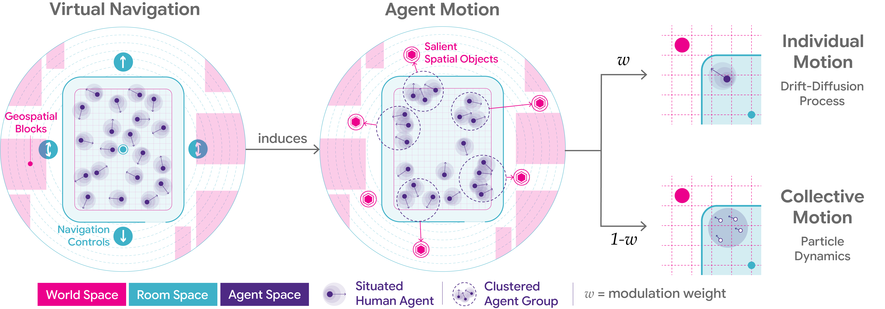

# TogetherFlow
Modeling multi-agent motion dynamics in immersive rooms



This repository contains the simulation and neural estimator results from our paper, [Modeling multi-agent motion dynamics in immersive rooms](https://arxiv.org/abs/2511.08763).

## Graphical partial pooling

The weight/radius hierarchy also has a BayesFlow graphical implementation using
separate flow-matching networks for population parameters and joint agent
parameters. See [the pipeline documentation](docs/graphical_partial_pooling.md)
for its model, training settings, and outputs.

```bash
PYTHONPATH=. .venv/bin/python experiments/run_graphical_partial_pooling.py --smoke
```
