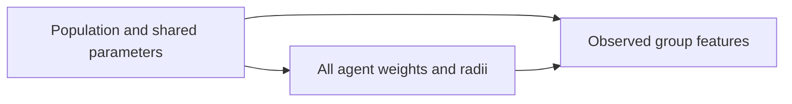

# Graphical partial pooling for weights and radii

`experiments/run_graphical_partial_pooling.py` trains BayesFlow's experimental
`GraphicalApproximator` on simulations from `GraphicalSimulator`. The model has
12 interacting agents, with an individual weight and radius for each agent.

## Model and posterior

The generative graph is:



The population node contains `mu_w, sigma_w, mu_r, sigma_r, v, eta`. The agent
node contains all 12 weights followed by all 12 radii. The observation node runs
the existing TogetherFlow motion kernel for 20 seconds with those exact agent
parameters. It computes the same 1,224 observable features as
`run_agent_radius_pooling.py`, using fixed reference radii rather than latent
radii. No agent parameters enter the feature calculation directly.

Weights follow a logit-normal hierarchy. Radii follow a scaled logit-normal
hierarchy bounded by 10. Population priors match the bounded-radius basic
pipeline. Parameters are represented in unconstrained coordinates for inference
and converted back to physical units for diagnostics.

Graph inversion produces:

1. A six-dimensional flow-matching network for population/shared parameters,
   conditioned on the observed group features.
2. A 24-dimensional flow-matching network for all agent parameters jointly,
   conditioned on population/shared parameters and the observed group features.

During training, the second network conditions on simulated population truths.
During posterior sampling, it conditions on draws from the first network.
The runner checks this factorization before training. Agents are not treated as
independent evidence blocks, and this does not use `CompositionalWorkflow`.

## Run

From the repository root, using the main BayesFlow environment:

```bash
PYTHONPATH=. .venv/bin/python experiments/run_graphical_partial_pooling.py --smoke
PYTHONPATH=. .venv/bin/python experiments/run_graphical_partial_pooling.py \
  --out outputs/graphical-partial-pooling/offline
```

The runner defaults to JAX on CPU. Set `JAX_PLATFORMS` before launching to choose
another installed device backend. The output directory must be new.

Default training is **offline**: 5,000 training groups, 300 validation groups,
300 held-out groups, batch size 32, and up to 300 epochs. Adam uses learning rate
0.001. Early stopping has patience 25 and restores the lowest-validation-loss
weights. Both networks use three hidden layers of width 256 and time embedding
size 32. Evaluation draws 1,000 posterior samples per held-out group.

`--smoke` uses 16/4/4 groups, two epochs, batch size eight, 20 posterior samples,
and two layers of width 32. Physical simulation settings remain unchanged.
These small runs validate execution, not scientific recovery.

This is separate from the basic pipeline, whose default training is online.
A comparison must align training budgets and held-out banks; equal prior
specifications do not imply identical simulated datasets.

## Saved results

The output directory contains the run manifest, graph structure and network
assignments, train/validation/test banks, training history, and `model.keras`.
The runner reloads the checkpoint before sampling. Posterior draws and truths,
per-parameter recovery/calibration metrics, within-group diagnostics, individual
posteriors, and recovery figures use the existing radius-pooling reporting code.

To reload a model in another Python process, expose the graph's module-level
sampling functions on the import path:

```bash
PYTHONPATH=.:experiments KERAS_BACKEND=jax JAX_PLATFORMS=cpu .venv/bin/python
```

```python
import keras
import graphical_partial_pooling  # registers/imports the graph's dependencies

model = keras.models.load_model("outputs/graphical-partial-pooling/offline/model.keras", compile=False)
```

The installed experimental API expects an observation axis. Features therefore
have shape `(groups, 1, 1224)`; parameter-free flatten layers remove that axis
for conditioning. Flow-matching networks are built explicitly before training.
These adaptations live in the project; installed BayesFlow files are not edited.

## Calibration plots from saved posteriors

Generate coverage curves and marginal rank ECDF difference plots without
retraining:

```bash
PYTHONPATH=. .venv/bin/python experiments/plot_partial_pooling_calibration.py
```

By default, this processes the graphical offline and basic bounded-radius online
runs. Pass one or more run directories to plot other saved joint weight/radius
posteriors. Each run receives `coverage.pdf`, `calibration_ecdf.pdf`, matching
PNG files, and `calibration_plots.json` recording the posterior hash and plotting
settings. The 30 panels follow the recovery figure's ordering and colors.

Coverage plots show central credible-interval coverage over nominal levels.
ECDF plots show marginal fractional-rank deviations from uniformity, with 95%
simultaneous bands within each parameter. These bands are not a joint test across
all 30 parameters.
