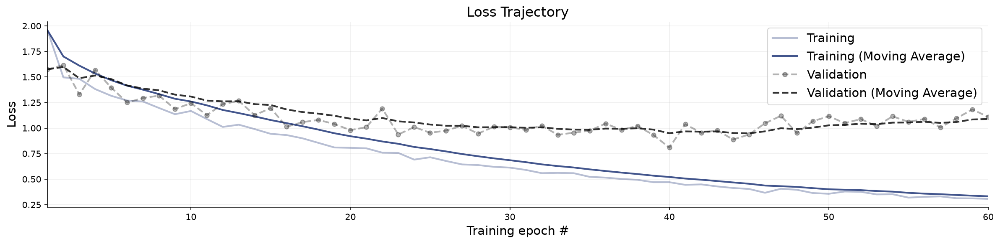
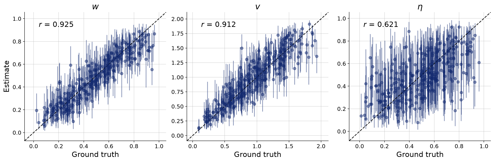
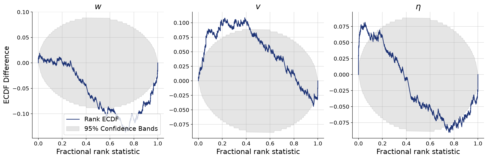
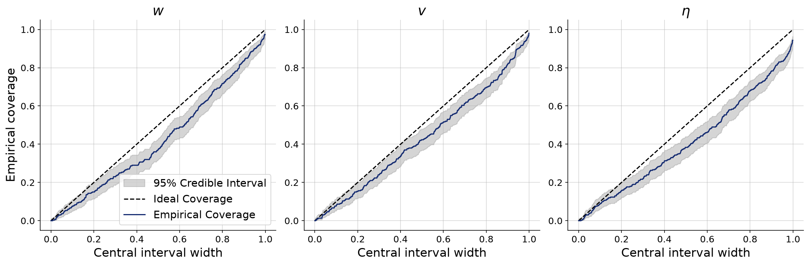
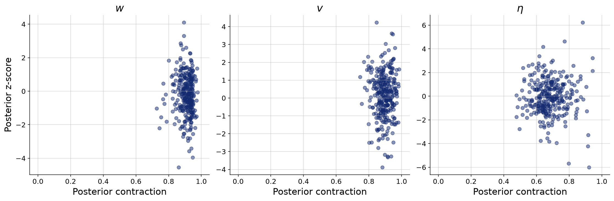

# Sensing radius held as a known constant

**Variant:** `rev-fixed-offline-3k`  
**Addresses:** R2 point 3

## Why this arm exists

Offline 3K with validation-selected weights versus fresh online batches. Other reference settings matched.

## Generative Configuration

| Setting | Value |
|---------|-------|
| Reviewer point addressed | R2 point 3 |
| Prior | fixed_radius_prior |
| Inferred parameters | w, v, noise |
| Observable channels | positions, rotations, neighbors, distances, angular_velocities, neighbor_fluctuations |
| Reference radii (r-free counts) | — |
| Beacon strengths | uniform |
| Beacon spread | 50 |
| Beacon salience | static |
| Heading update | relative bearing (rotationally invariant) |
| Agents / beacons | 49 / 4 |
| Time horizon / dt | 60s / 0.1 |
| Seed | 20260803 |

## Training and Network Configuration

| Setting | Value |
|---------|-------|
| Inference network | flow_matching (widths 256x4, time_embedding_dim 32) |
| Summary network | TransformerSummaryNet — TimeSeriesTransformer, Base (summary_dim=9) |
| Epochs | 300 |
| Batch size | 32 |
| Validation data | 300 simulations |
| Test data | 300 simulations |
| Training mode | offline |
| Early stopping | patience 20, best weights restored |
| Simulation budget | 3000 training simulations |
| Wall-clock | 6.0 min |

## Convergence

The training loss curve shows the optimization objective over epochs. A healthy curve decreases smoothly and plateaus. Key warning signs: (i) a growing gap between training and validation loss indicates overfitting; (ii) loss still visibly decreasing at the final epoch means the network could benefit from more epochs; (iii) NaN spikes indicate numerical instability, often caused by extreme simulator outputs or missing standardization.

**Assessment:** No non-finite losses detected. This check does not establish convergence; inspect the loss curves.

## Parameter Recovery

Each panel plots the posterior median (point estimate) against the true parameter value across held-out simulations. Points falling on the diagonal indicate perfect recovery. Vertical bars represent 95% posterior credible intervals — their width reflects estimation uncertainty. Systematic deviations from the diagonal reveal bias; wide intervals indicate the data are only weakly informative for that parameter.

**Assessment:** No per-parameter ratings were available.

## Calibration and Coverage

**Calibration ECDF** — Simulation-based calibration (SBC) plots show the empirical CDF of posterior ranks. Well-calibrated posteriors produce ECDFs close to the uniform diagonal. Systematic deviations indicate non-uniform ranks; their shape can reflect bias or dispersion errors. Use the coverage plot to assess interval width rather than assigning dispersion from the sign alone.

**Coverage** — Shows the fraction of held-out true values falling within nominal credible intervals (e.g., 50%, 80%, 95%). Well-calibrated models yield empirical coverage matching the nominal level. Under-coverage means the credible intervals are too narrow; over-coverage means they are too wide.

**Assessment:** No per-parameter ratings were available.

## Posterior Z-Score and Contraction

The z-score–contraction plot summarizes posterior quality in two dimensions. The x-axis shows **posterior contraction** — the fraction by which the posterior variance has shrunk relative to the prior variance. Values near 0 indicate no information gain (the data are uninformative for that parameter); values near 1 indicate near-complete information gain. The y-axis shows the **posterior z-score** — the average standardized deviation between the posterior mean and the true value. Symmetric values around 0 indicate an unbiased (Gaussian-like) posterior. The ideal region is the middle-right corner (z-scores distributed around 0, high contraction).

**Assessment:** No per-parameter ratings were available.

## Numerical Diagnostic Summary

| Metric | w | v | noise |
|--------|-----|-----|-----|
| NRMSE | 0.294 | 0.332 | 0.609 |
| Log-gamma | -7.831 | -7.789 | -23.339 |
| ECE | 0.085 | 0.063 | 0.108 |
| Post. Contraction | 0.917 | 0.895 | 0.677 |

**w** — NRMSE=0.294; Log-gamma=-7.831; ECE=0.085; Post. Contraction=0.917

**v** — NRMSE=0.332; Log-gamma=-7.789; ECE=0.063; Post. Contraction=0.895

**noise** — NRMSE=0.609; Log-gamma=-23.339; ECE=0.108; Post. Contraction=0.677

## Suggested Next Steps

1. Inspect recovery, coverage, and rank plots jointly; no automatic threshold establishes identifiability or convergence.
