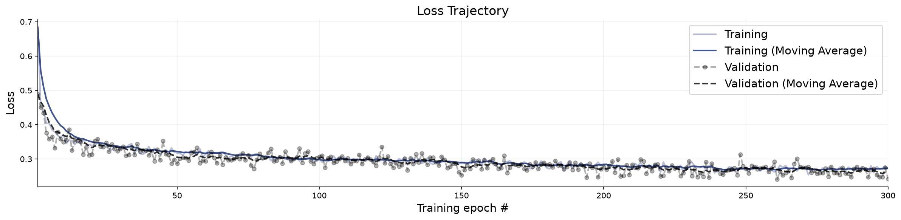
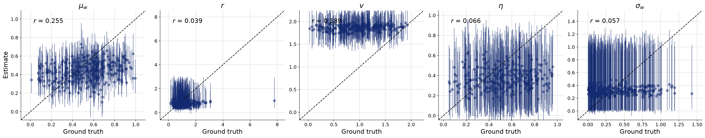
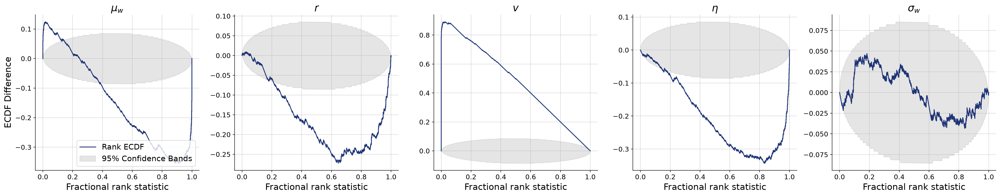
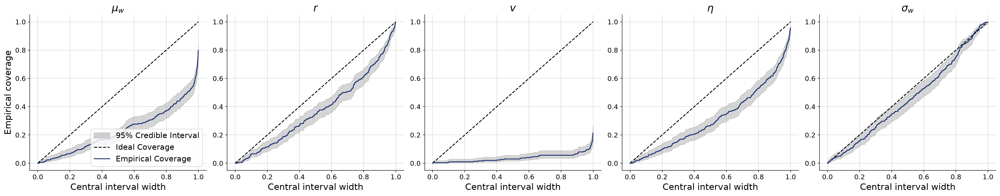
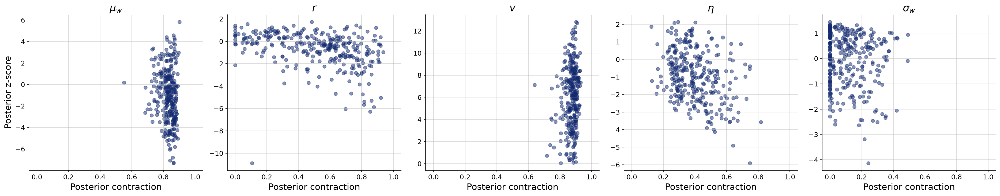

# Per-agent influence weight, population-level inference

**Variant:** `rev-variable-partial`  
**Addresses:** Reviewer point 4 / R2 weakness 2

## Why this arm exists

Radius is drawn per trial from LogNormal(0, 0.5) and inferred. Inputs use observed trajectories and counts at fixed reference distances; no neighbor statistics computed at the true radius enter inference. This companion analysis preserves all fixed-radius results.

## Generative Configuration

| Setting | Value |
|---------|-------|
| Reviewer point addressed | Reviewer point 4 / R2 weakness 2 |
| Prior | partial_pooling_prior |
| Inferred parameters | mu_w, r, v, noise, sigma_w |
| Observable channels | positions, rotations, angular_velocities, radii_counts |
| Reference radii (r-free counts) | [0.5, 1.0, 2.0, 4.0] |
| Beacon strengths | uniform |
| Beacon spread | 50 |
| Beacon salience | static |
| Heading update | relative bearing (rotationally invariant) |
| Agents / beacons | 49 / 4 |
| Time horizon / dt | 20s / 0.1 |
| Seed | 20260803 |

## Training and Network Configuration

| Setting | Value |
|---------|-------|
| Inference network | diffusion (widths 256x4, time_embedding_dim 32) |
| Summary network | SummaryNet — Conv1D + BiLSTM (summary_dim=15) |
| Epochs | 300 |
| Batch size | 32 |
| Validation data | 300 simulations |
| Test data | 300 simulations |
| Training mode | online |
| Early stopping | off |
| Simulation budget | 300 x 50 x 32 (online, fresh each batch) |
| Wall-clock | 12.9 min |

## Convergence

The training loss curve shows the optimization objective over epochs. A healthy curve decreases smoothly and plateaus. Key warning signs: (i) a growing gap between training and validation loss indicates overfitting; (ii) loss still visibly decreasing at the final epoch means the network could benefit from more epochs; (iii) NaN spikes indicate numerical instability, often caused by extreme simulator outputs or missing standardization.

**Assessment:** No non-finite losses detected. This check does not establish convergence; inspect the loss curves.

## Parameter Recovery

Each panel plots the posterior median (point estimate) against the true parameter value across held-out simulations. Points falling on the diagonal indicate perfect recovery. Vertical bars represent 95% posterior credible intervals — their width reflects estimation uncertainty. Systematic deviations from the diagonal reveal bias; wide intervals indicate the data are only weakly informative for that parameter.

**Assessment:** No per-parameter ratings were available.

## Calibration and Coverage

**Calibration ECDF** — Simulation-based calibration (SBC) plots show the empirical CDF of posterior ranks. Well-calibrated posteriors produce ECDFs close to the uniform diagonal. Systematic deviations indicate non-uniform ranks; their shape can reflect bias or dispersion errors. Use the coverage plot to assess interval width rather than assigning dispersion from the sign alone.

**Coverage** — Shows the fraction of held-out true values falling within nominal credible intervals (e.g., 50%, 80%, 95%). Well-calibrated models yield empirical coverage matching the nominal level. Under-coverage means the credible intervals are too narrow; over-coverage means they are too wide.

**Assessment:** No per-parameter ratings were available.

## Posterior Z-Score and Contraction

The z-score–contraction plot summarizes posterior quality in two dimensions. The x-axis shows **posterior contraction** — the fraction by which the posterior variance has shrunk relative to the prior variance. Values near 0 indicate no information gain (the data are uninformative for that parameter); values near 1 indicate near-complete information gain. The y-axis shows the **posterior z-score** — the average standardized deviation between the posterior mean and the true value. Symmetric values around 0 indicate an unbiased (Gaussian-like) posterior. The ideal region is the middle-right corner (z-scores distributed around 0, high contraction).

**Assessment:** No per-parameter ratings were available.

## Numerical Diagnostic Summary

| Metric | mu_w | r | v | noise | sigma_w |
|--------|-----|-----|-----|-----|-----|
| NRMSE | 0.725 | 0.824 | 1.701 | 1.000 | 0.952 |
| Log-gamma | -inf | -43.681 | -inf | -115.828 | 2.113 |
| ECE | 0.293 | 0.121 | 0.468 | 0.211 | 0.045 |
| Post. Contraction | 0.838 | 0.537 | 0.880 | 0.368 | 0.099 |

**mu_w** — NRMSE=0.725; Log-gamma=-inf; ECE=0.293; Post. Contraction=0.838

**r** — NRMSE=0.824; Log-gamma=-43.681; ECE=0.121; Post. Contraction=0.537

**v** — NRMSE=1.701; Log-gamma=-inf; ECE=0.468; Post. Contraction=0.880

**noise** — NRMSE=1.000; Log-gamma=-115.828; ECE=0.211; Post. Contraction=0.368

**sigma_w** — NRMSE=0.952; Log-gamma=2.113; ECE=0.045; Post. Contraction=0.099

## Suggested Next Steps

1. Inspect recovery, coverage, and rank plots jointly; no automatic threshold establishes identifiability or convergence.
