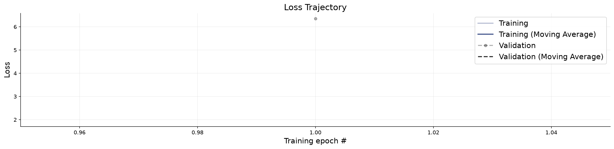
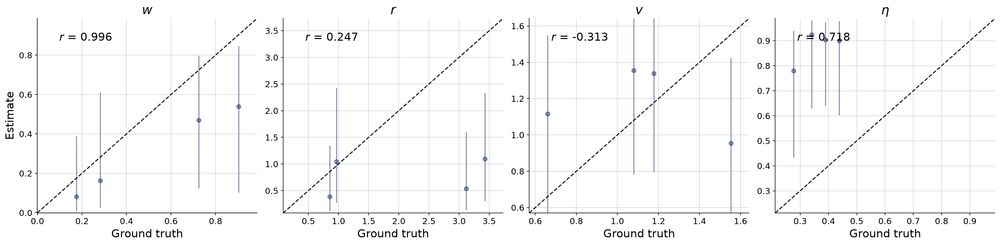
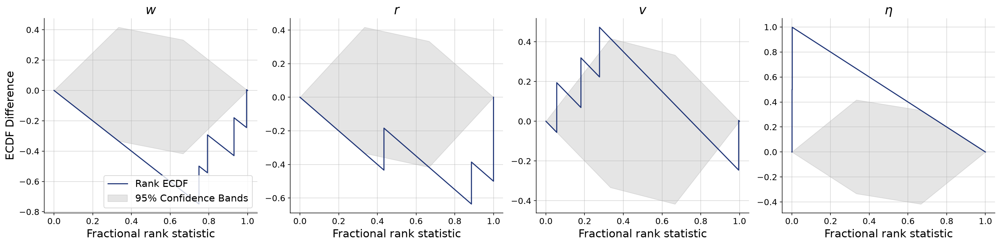
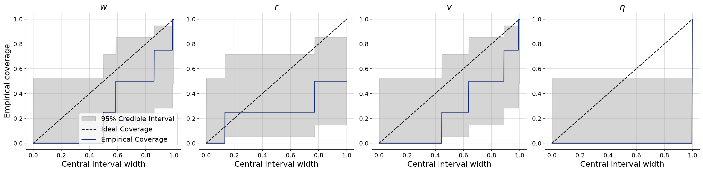
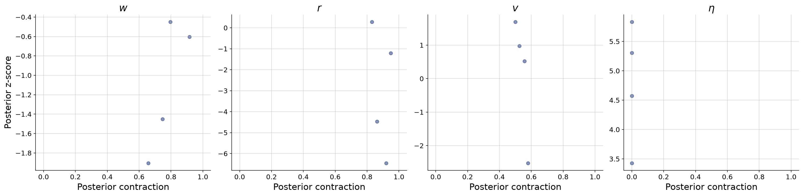

# Reference model (transformer summary net, relative heading)

**Variant:** `rev-variable-reference-smoke`  
**Addresses:** Reference arm (no reviewer point directly)

## Why this arm exists

Radius is drawn per trial from LogNormal(0, 0.5) and inferred. Inputs use observed trajectories and counts at fixed reference distances; no neighbor statistics computed at the true radius enter inference. This companion analysis preserves all fixed-radius results.

## Generative Configuration

| Setting | Value |
|---------|-------|
| Reviewer point addressed | Reference arm (no reviewer point directly) |
| Prior | complete_pooling_prior |
| Inferred parameters | w, r, v, noise |
| Observable channels | positions, rotations, angular_velocities, radii_counts |
| Reference radii (r-free counts) | [0.5, 1.0, 2.0, 4.0] |
| Beacon strengths | uniform |
| Beacon spread | 50 |
| Beacon salience | static |
| Heading update | relative bearing (rotationally invariant) |
| Agents / beacons | 4 / 4 |
| Time horizon / dt | 2s / 0.1 |
| Seed | 20260803 |

## Training and Network Configuration

| Setting | Value |
|---------|-------|
| Inference network | flow_matching (widths 256x4, time_embedding_dim 32) |
| Summary network | TransformerSummaryNet — TimeSeriesTransformer, Base (summary_dim=12) |
| Epochs | 1 |
| Batch size | 4 |
| Validation data | 4 simulations |
| Test data | 4 simulations |
| Training mode | online |
| Early stopping | off |
| Simulation budget | 1 x 1 x 4 (online, fresh each batch) |
| Wall-clock | 0.6 min |

## Convergence

The training loss curve shows the optimization objective over epochs. A healthy curve decreases smoothly and plateaus. Key warning signs: (i) a growing gap between training and validation loss indicates overfitting; (ii) loss still visibly decreasing at the final epoch means the network could benefit from more epochs; (iii) NaN spikes indicate numerical instability, often caused by extreme simulator outputs or missing standardization.

**Assessment:** No non-finite losses detected. This check does not establish convergence; inspect the loss curves.

## Parameter Recovery

Each panel plots the posterior median (point estimate) against the true parameter value across held-out simulations. Points falling on the diagonal indicate perfect recovery. Vertical bars represent 95% posterior credible intervals — their width reflects estimation uncertainty. Systematic deviations from the diagonal reveal bias; wide intervals indicate the data are only weakly informative for that parameter.

**Assessment:** No per-parameter ratings were available.

## Calibration and Coverage

**Calibration ECDF** — Simulation-based calibration (SBC) plots show the empirical CDF of posterior ranks. Well-calibrated posteriors produce ECDFs close to the uniform diagonal. Systematic deviations indicate non-uniform ranks; their shape can reflect bias or dispersion errors. Use the coverage plot to assess interval width rather than assigning dispersion from the sign alone.

**Coverage** — Shows the fraction of held-out true values falling within nominal credible intervals (e.g., 50%, 80%, 95%). Well-calibrated models yield empirical coverage matching the nominal level. Under-coverage means the credible intervals are too narrow; over-coverage means they are too wide.

**Assessment:** No per-parameter ratings were available.

## Posterior Z-Score and Contraction

The z-score–contraction plot summarizes posterior quality in two dimensions. The x-axis shows **posterior contraction** — the fraction by which the posterior variance has shrunk relative to the prior variance. Values near 0 indicate no information gain (the data are uninformative for that parameter); values near 1 indicate near-complete information gain. The y-axis shows the **posterior z-score** — the average standardized deviation between the posterior mean and the true value. Symmetric values around 0 indicate an unbiased (Gaussian-like) posterior. The ideal region is the middle-right corner (z-scores distributed around 0, high contraction).

**Assessment:** No per-parameter ratings were available.

## Numerical Diagnostic Summary

| Metric | w | r | v | noise |
|--------|-----|-----|-----|-----|
| NRMSE | 0.582 | 0.878 | 1.040 | 5.990 |
| Log-gamma | -0.248 | -5.678 | 1.377 | -14.887 |
| ECE | 0.203 | 0.250 | 0.271 | 0.500 |
| Post. Contraction | 0.752 | 0.888 | 0.537 | 0.000 |

**w** — NRMSE=0.582; Log-gamma=-0.248; ECE=0.203; Post. Contraction=0.752

**r** — NRMSE=0.878; Log-gamma=-5.678; ECE=0.250; Post. Contraction=0.888

**v** — NRMSE=1.040; Log-gamma=1.377; ECE=0.271; Post. Contraction=0.537

**noise** — NRMSE=5.990; Log-gamma=-14.887; ECE=0.500; Post. Contraction=0.000

## Suggested Next Steps

1. Inspect recovery, coverage, and rank plots jointly; no automatic threshold establishes identifiability or convergence.
